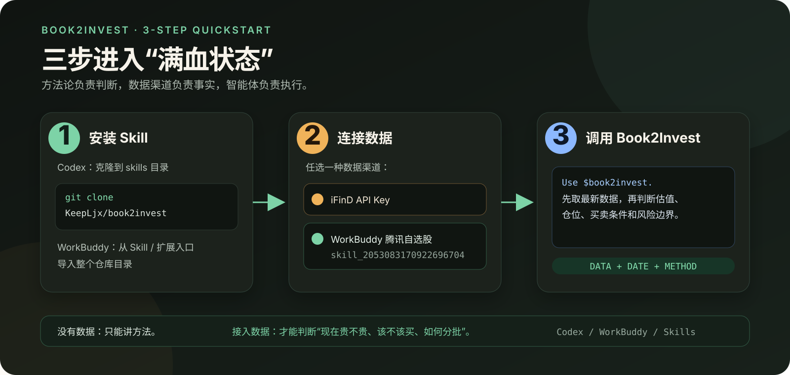
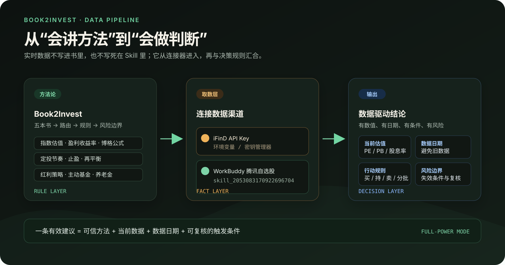
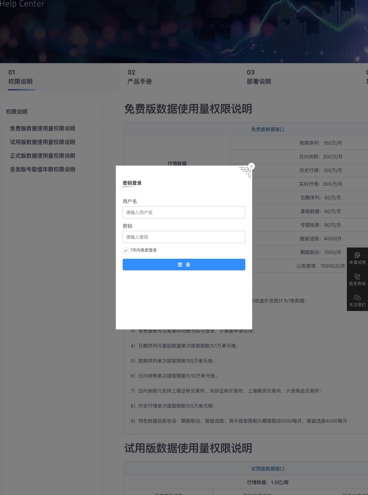
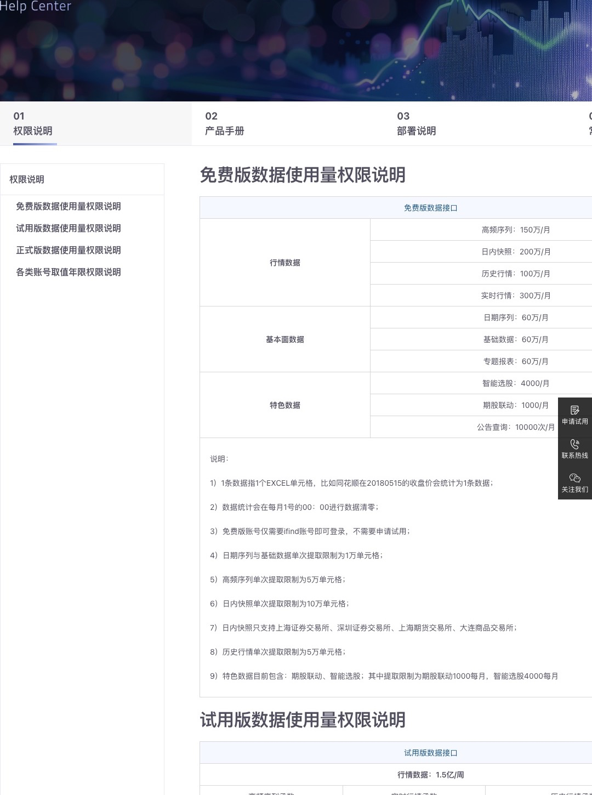
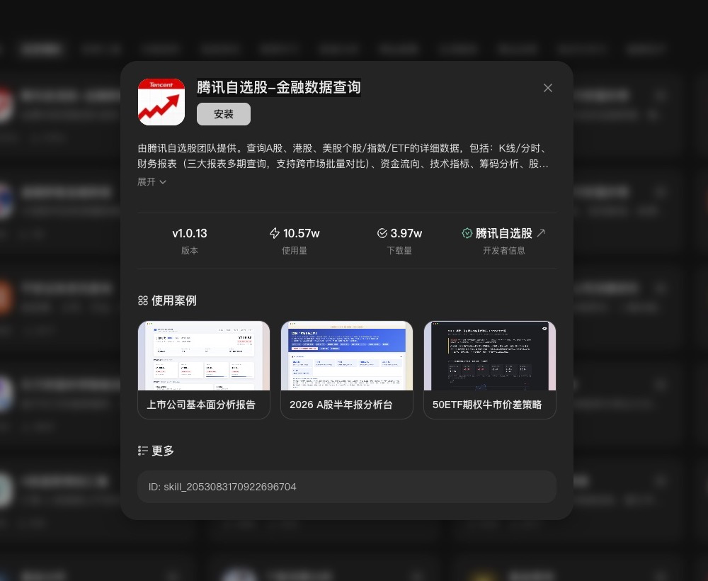

# Book2Invest

把银行螺丝钉的五本基金投资书整理成一个跨智能体可用的 Skill，用同一套流程处理基金选择、估值、定投、组合配置与退休规划。



## 兼容智能体

本项目采用通用的 `SKILL.md` + `references/` 目录结构，不绑定 Codex 的专有接口。Codex、WorkBuddy，以及其他支持加载本地 Skill 目录的智能体都可以使用；调用方式可以是 `$book2invest`，也可以直接用自然语言提出投资问题。

不同智能体的安装入口和调用语法可能不同，但核心要求相同：完整保留仓库中的 `SKILL.md` 与 `references/` 目录，不要把其中的 Markdown 文件拆散。

## 覆盖范围

| 模块 | 解决的问题 |
|---|---|
| 指数基金 | 品种分类、指数估值、盈利收益率法、博格公式、定投与家庭资产配置 |
| 定投与财务自由 | 4% 法则、定期不定额、估值定投、止盈、养老/教育/加薪计划 |
| 红利指数基金 | 红利指数分类、股息率、分红处理、持股收息与风格轮动 |
| 主动基金 | 基金经理风格、基金分析、基金池、组合构建与再平衡 |
| 个人养老金 | 税优测算、开户与领取、五类品种、养老 FOF 与指数基金策略 |

`book2invest` 是唯一入口。它会先识别问题涉及哪一本书，再按需读取对应总览和专题资料，因此安装后不需要分别加载五个 Skill。

## 安装

### Codex

将仓库克隆到 Codex 的用户级 Skill 目录：

```bash
git clone https://github.com/KeepLjx/book2invest.git \
  "${CODEX_HOME:-$HOME/.codex}/skills/book2invest"
```

国内网络也可以从 Gitee 克隆：

```bash
git clone https://gitee.com/KeepLjx/book2invest.git \
  "${CODEX_HOME:-$HOME/.codex}/skills/book2invest"
```

确认目录结构如下，然后重新打开 Codex：

```text
~/.codex/skills/book2invest/
├── SKILL.md
├── agents/openai.yaml
└── references/
    ├── index-fund-investment/
    ├── dca-financial-freedom/
    ├── dividend-fund-investment/
    ├── active-fund-investment/
    └── personal-pension-investment/
```

### WorkBuddy 与其他智能体

在智能体的 Skill / 扩展入口中导入本仓库目录，或把目录放到该智能体支持的本地 Skill 路径。目录名称保持为 `book2invest`，并确认 `SKILL.md`、`references/` 和 `agents/openai.yaml` 仍然在一起。

## 数据接入（满血状态）

本 Skill 负责方法论、问题路由和决策框架，不内置实时行情数据库。股票和基金的价格、估值、盈利、股息率、规模、持仓、费率及利率等数据必须从外部数据源获取，不能用书中的历史数字代替当前市场数据。



### 方式一：iFinD API

打开 [同花顺数据接口官网](https://quantapi.10jqka.com.cn/)，页面顶部可以看到“登录”“申请试用”和主要数据能力：


1. 点击右上角“登录”。没有账号时，按页面提示注册，或根据需要申请试用。
2. 登录后进入 iFinD 数据接口控制台，按当前账号版本开通接口能力并创建/查看 API Key。具体菜单名称可能随账号版本更新，以页面显示为准。
3. 把 API Key 配置到 Codex、WorkBuddy 或其他智能体支持的 API、MCP 或工具适配器中。
4. Key 只保存在环境变量或密钥管理器中，不提交到仓库，不截图，也不直接写进对话。
5. 先用一组已知数据测试连接，确认返回值、字段口径和数据日期无误。

登录入口和账号验证界面如下：



免费版和试用版的接口额度不同，正式使用前可先在官方[帮助中心 → 权限说明](https://quantapi.10jqka.com.cn/gwstatic/static/ds_web/quantapi-web/help-center/permission.html)核对当前额度：



### 方式二：WorkBuddy 免费数据 Skill

在 WorkBuddy 顶部进入 **专家·技能·连接器 → 技能**，搜索：

- 名称：**腾讯自选股-金融数据查询**
- Skill ID：`skill_2053083170922696704`



操作步骤：

1. 核对名称和右下角的 Skill ID。
2. 点击技能卡片上的“安装”。
3. 新建任务，在需要股票、指数、ETF 或基金数据时，明确告诉智能体使用该 Skill。
4. 获取数据后，让同一个智能体调用 `book2invest` 完成方法论判断和行动方案。

启用后，可以用它查询股票、基金和行情相关数据，再把结果交给 `book2invest` 做估值判断、组合分析和行动计划。免费额度、覆盖字段和可用性以 WorkBuddy 页面为准。

### “满血”工作流

1. `book2invest` 先确定需要哪些数据和判断规则。
2. iFinD 或“腾讯自选股-金融数据查询”获取当前数据并注明日期。
3. `book2invest` 结合五本书的方法论给出结论、执行条件和风险边界。

没有接入数据渠道时，Skill 仍可用于知识讲解、方法论梳理和基于用户提供数据的条件分析，但无法可靠回答“现在是否低估”“今天该不该买卖”等依赖实时数据的问题。接入 iFinD 或 WorkBuddy 数据 Skill 后，才是完整的数据驱动状态。

可以直接使用下面这条提示词：

```text
使用 book2invest，并结合“腾讯自选股-金融数据查询”Skill。
先获取沪深300当前估值、近10年估值分位、股息率和数据日期，
再按照指数基金与定投方法论，给出买入、持有、止盈条件和风险边界。
```

## 使用

显式调用：

```text
Use $book2invest to help me design a long-term fund investment plan.
```

也可以直接用自然语言提问，例如：

- “我有 30 万闲钱，准备 10 年后使用，应该怎样配置？”
- “现在该不该继续定投沪深 300？”
- “这只主动基金值不值得留？”
- “个人养老金账户适合买什么？”
- “红利基金的分红和止盈应该怎么处理？”

## 设计原则

- 一个入口，五个知识模块，按问题渐进加载。
- 先确定目标、期限和账户，再选择品种与执行方式。
- 原则与历史数据分开；实时估值、利率、费率、政策与产品名单必须重新核验。
- 输出结论、假设、执行规则、风险和数据日期，避免“无脑买”和短期预测。
- 投资教育优先，不虚构实时数据，不承诺收益，不替代持牌投资顾问。

## 目录来源

本体系整理自以下五本书的方法论，书名和原作者权益归各自权利人所有：

1. 《指数基金投资指南》
2. 《定投十年财务自由》
3. 《红利指数基金投资指南》
4. 《主动基金投资指南》
5. 《个人养老金投资指南》

本仓库是学习型知识整理和软件封装，不包含原书全文。引用书籍数据时会保留其历史时点，并提示用最新数据校准。公开分发或商业使用前，请自行确认内容授权与所在地合规要求。

## 验证

使用 Codex `skill-creator` 自带的校验器：

```bash
python3 ~/.codex/skills/.system/skill-creator/scripts/quick_validate.py .
```
